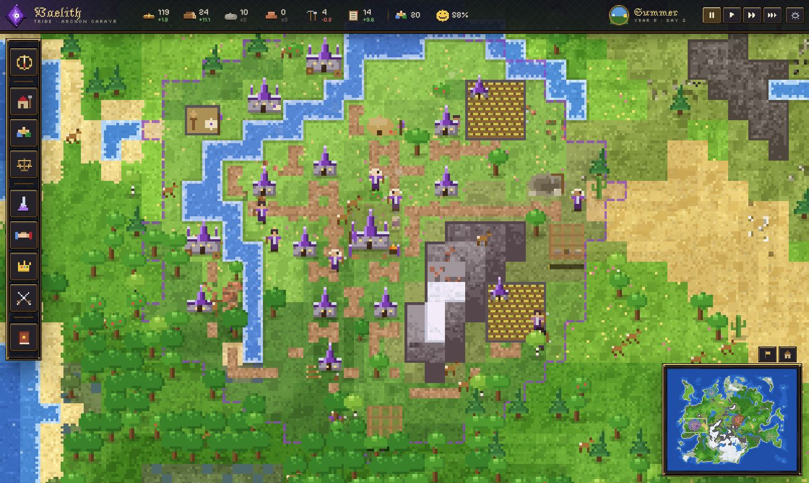
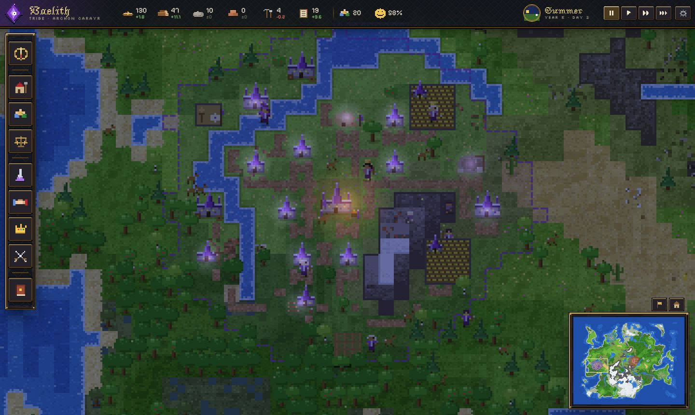
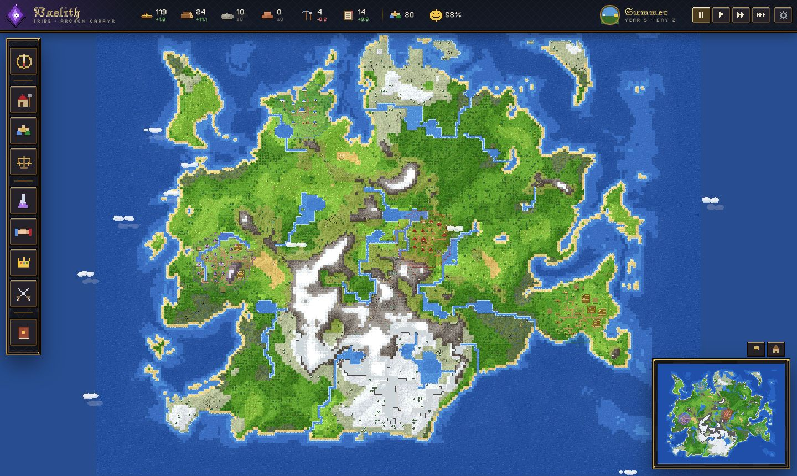
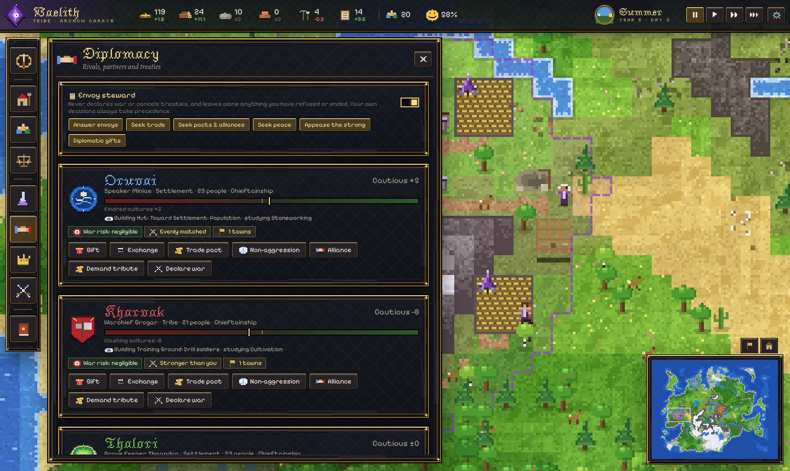
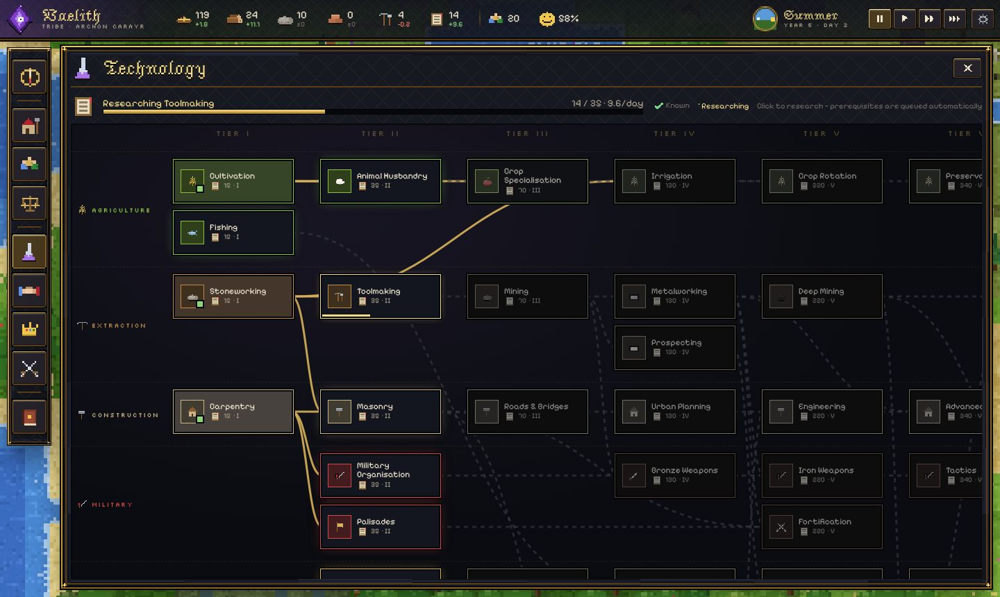

<div align="center">

# ⚔️ C I V S I M ⚔️

### *A living-world civilisation chronicle in your browser*

<br>

<a href="https://playcivsim.github.io/CivSim/"></a>
&nbsp;&nbsp;&nbsp;
<a href="https://playcivsim.github.io/CivSim/game.html"></a>

<sub>No install, no sign-up — it runs straight in your browser, on desktop or phone.</sub>

<br><br>



<br>


</div>

---

Four peoples — the diplomatic **Oruvai**, the martial **Kharvak**, the agrarian **Thalori** and the inventive **Vaelith** — rise from a single hearth on a procedurally generated continent. You lead one. The other three are rulers with their own temperaments, memories and plans.

Every person is simulated. Every sprite, icon and banner is drawn in code, and all music and sound is synthesised live. No assets, no dependencies.

<table>
<tr>
<td width="50%" valign="top">

### 🏰 Build a civilisation
Grow from a tribe to an advanced civilisation through six stages and seven technology eras. Assign workers, raise towns, give each settlement a focus, pass laws and reform your government.

### 🕵️ Know your enemy
On Hard, you only see what your people see. Reports are **rumoured, reported or verified** — and they go stale. Send scouts, envoys and agents; catch the spies sent against you.

### 🤝 Negotiate everything
Envoys really travel — and can be delayed or lost. Trade deals, supply contracts, counteroffers, border access, exclusivity, embargoes and tariffs. Rivals remember every gift and betrayal.

</td>
<td width="50%" valign="top">

### ⚔️ Plan your wars
Before you march, see the distance, terrain, food to carry, supply lines, sickness and ambush risk. Armies eat on the road and wither far from home.

### ⛏️ Reach beyond your borders
Send miners and woodcutters to outposts on rich deposits and forests — if bandits and jealous neighbours let you keep them.

### 📜 Live your history
A full chronicle, a timeline of great moments, statistics graphs, five rotating autosaves and an encyclopedia of every mechanic. A hands-on tutorial throws you into famine, invasion and war.

</td>
</tr>
</table>

<div align="center">

| | |
|---|---|
|  |  |
|  |  |

### [🌍 Visit the website](https://playcivsim.github.io/CivSim/) &nbsp;·&nbsp; [▶ Play now](https://playcivsim.github.io/CivSim/game.html)

</div>

---

## Running

```bash
node server.mjs
```

Then open <http://localhost:8080> for the website, or <http://localhost:8080/game.html> to play. Any static file server works (the game is plain ES modules); it just needs to be served over HTTP rather than opened as a `file://` URL. All fonts are bundled in `fonts/` (SIL OFL), so the game makes no network requests and looks identical offline.

## Controls

| Input | Action |
|---|---|
| Drag (left/right/middle), WASD / arrows | Pan (Shift = faster) |
| Mouse wheel, Q / E | Zoom |
| Click | Inspect a person, building or tile |
| Space · 1 · 2 · 3 | Pause · normal · fast · very fast |
| B · P · O · T · G · L · M · C (or F1–F9) | Build · Population · Economy · Technology · Diplomacy · Laws · Military · Chronicle |
| H | Return to your capital |
| F5 | Quicksave |
| Esc | Cancel / menu |

## Playing

Pick a tribe, a seed, map size, difficulty and starting conditions. Your people start with a hearth, a few huts, a forager camp and a lumber camp. From there you:

- **Allocate workers** (Population) to the jobs your buildings provide. Every job is visible on the map: woodcutters fell trees, miners disappear into mines, farmers tend fields that change with the seasons, haulers carry goods to storage.
- **Build** inside your territory. Territory grows as settlements grow and as you build outward.
- **Research** along seven connected branches. Prerequisites queue automatically; higher tiers require advancing your civilisation's stage.
- **Advance through six stages** (Tribe → Advanced Civilisation). Each needs a mix of population, technology, institutions and infrastructure, not just headcount.
- **Govern**: enact laws in limited slots and reform your government. Policies trade off against each other and some combinations interact.
- **Negotiate**: trade pacts, non-aggression, alliances, gifts, resource exchanges, tribute and peace terms. AI rulers explain why they accept or refuse.
- **Fight** when you must: recruit soldiers, forge weapons, raise towers and forts, and send armies against enemy towns.

**Stewards** (Overview panel) can take over routine work — workforce, housing, building and research — using the same reasoning as the rival AI. The **Envoy** (Diplomacy panel) is configurable: answer envoys, seek trade, seek pacts and alliances, seek peace, appease far stronger rivals, send calming gifts. It never declares war or cancels treaties and leaves alone anything you have personally refused or ended.

The Overview's **Advisor** shows what stands between you and the next stage and how each shortage could be solved.

**War never comes out of nowhere.** Rivals weigh expected plunder, towns and contested resources against expected losses, your allies and fortifications, their treaties and their standing with onlookers. Young peoples get a grace period. As hostility builds you are warned; an aggressor then issues an ultimatum (pay tribute or face war) before declaring. Raids on the same town have cooldowns, a victor whose peace terms are ignored eventually withdraws, and unprovoked wars, sacks and conquests cost the aggressor reputation with every other people.

## How it works

| Area | Where |
|---|---|
| World generation (continents, ridged mountain ranges, rivers, lakes, biomes, deposits, balanced starts) | `src/world/` |
| Fixed-tick simulation scheduler and save format | `src/sim/game.js` |
| Individual inhabitants: needs, jobs, work cycles, hauling, pathing | `src/sim/agents.js`, `src/sim/pathfinding.js` |
| Demographics, housing, workforce allocation, happiness & stability | `src/sim/population.js` |
| Buildings, territory, roads, settlement planner | `src/sim/buildings.js` |
| Economy ledger, storage, spoilage, tools, taxes | `src/sim/economy.js` |
| Research tree and civilisation stages | `src/data/techs.js`, `src/sim/progress.js` |
| Laws, governments, policy interactions | `src/data/laws.js`, `src/sim/government.js` |
| Diplomacy, treaties, trade caravans | `src/sim/diplomacy.js` |
| Armies, sieges, towers, conquest | `src/sim/military.js` |
| Contextual events and decisions | `src/sim/events.js` |
| Utility AI (also powers the player's optional stewards) | `src/sim/ai.js` |
| Progression planner, bottleneck resolution, stagnation detection | `src/sim/planner.js` |
| Worker host, protocol and main-thread mirror | `src/sim/host.js`, `src/sim/protocol.js`, `src/sim/client.js`, `src/sim/worker.js` |
| Renderer: chunked terrain, y-sorted sprites, lighting, weather | `src/render/` |
| Interface | `src/ui/`, `styles/ui.css` |
| Audio | `src/audio/audio.js` |
| IndexedDB saves (verified, atomic, with backups) | `src/save/saves.js` |

The simulation runs at 10 ticks per second of game time, independent of frame rate. Systems update at different cadences (movement every tick, census every second, jobs/needs every five seconds, economy, demographics, diplomacy and events once per in-game day). Off-screen inhabitants update at half frequency, pathfinding is budgeted per tick and cached, and terrain is baked into chunk canvases that only re-render when the world changes.

### Threads

The authoritative simulation runs in a **Web Worker** (`src/sim/worker.js` → `host.js`): agents, economy, population, AI, diplomacy, military, events and progression. The main thread renders, animates, handles input and the UI against a **mirror** `Game` that never steps:

- **Fast batches** (~20 Hz): agent state packed into a transferable `Float32Array` (14 floats per person), tile deltas for changed map regions, new effects, sound cues and simulation events. The main thread interpolates agent positions between batches, so motion is smooth at any speed.
- **Slow batches** (~4 Hz, or immediately after a command or event): tribes, settlements, armies, diplomacy, new chronicle entries, pending decisions and building **deltas** (full resync every 5 s).
- **Commands** (`sim.call(name, …args)`): every player action — placing buildings, laws, research, diplomacy, campaigns, speed, pause — is a whitelisted command executed by the worker; results come back as promises.

Read-only rules (placement checks, costs, tech states, proposal previews) run unchanged against the mirror. If module workers are unavailable the same host runs in-thread behind the same message protocol. On a large late-game world (~1,000 people) a fast batch is ~55 KB (zero-copy transfer) and a slow batch ~45 KB.

On a large map the simulation runs about 1,000 inhabitants at under 2 ms per tick, off the main thread, so the game holds 60 fps at the fastest speed. The simulation is deterministic for a given seed and command sequence.

### Development tools

```bash
node tools/balance.mjs 160 seed1 seed2   # AI-only worlds: progression, bottlenecks, food, survival
node tools/aggression.mjs 120 seed1      # passive player vs AI, with/without Envoy; determinism check
```

Saves store the world seed plus all mutable state (forests, deposits, fauna, roads, buildings, every inhabitant, AI state, diplomacy, history). Each save is serialised and verified before being written, and the previous version of the slot is kept as a backup in the same transaction.

## Publishing

The site deploys to GitHub Pages from `.github/workflows/pages.yml` on every push to `main` (set **Settings → Pages → Source** to **GitHub Actions** once).
